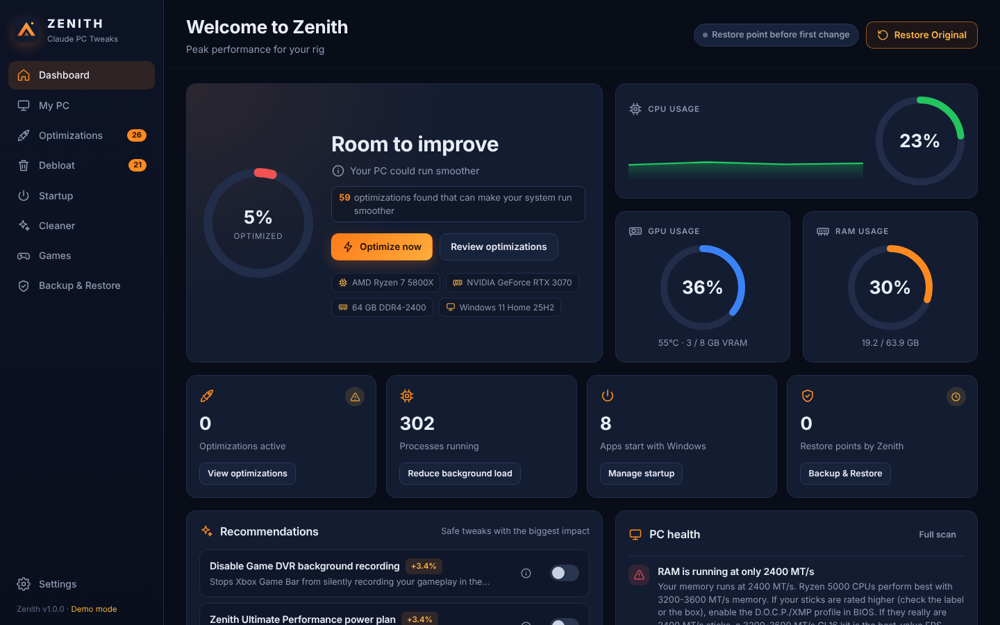
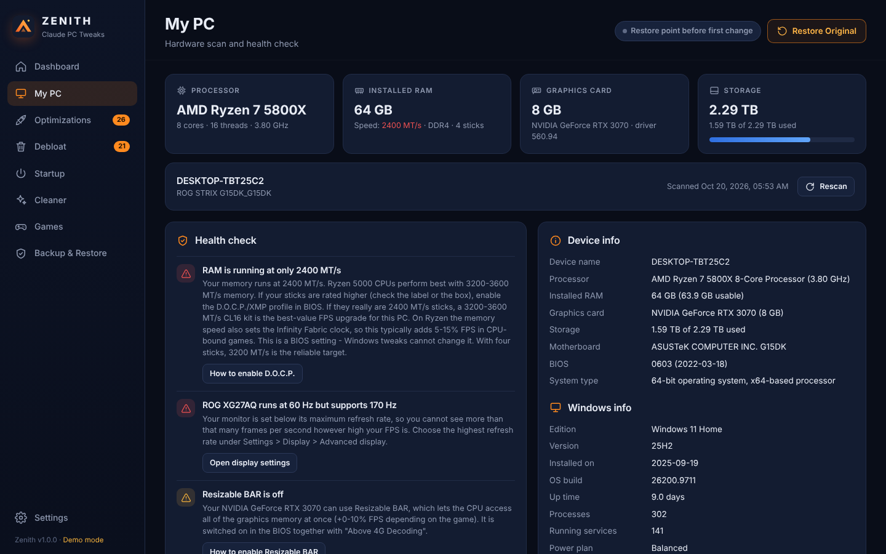
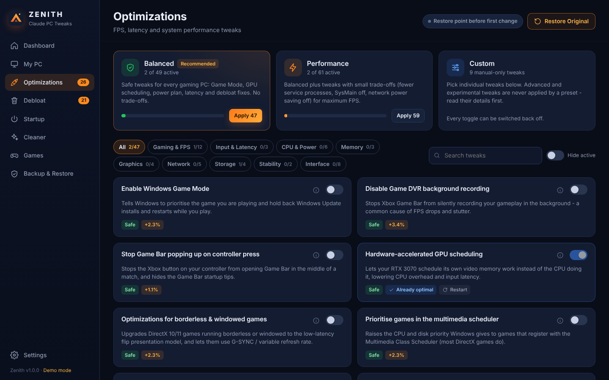
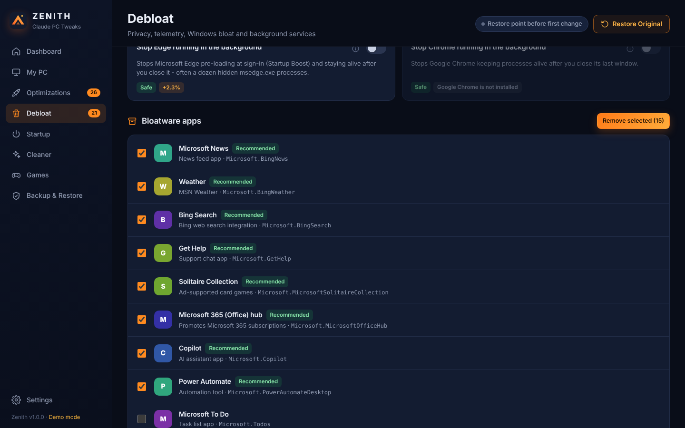
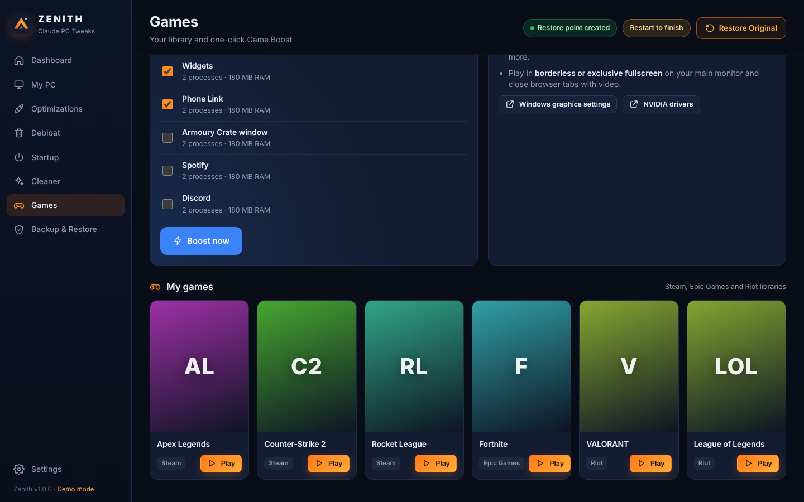
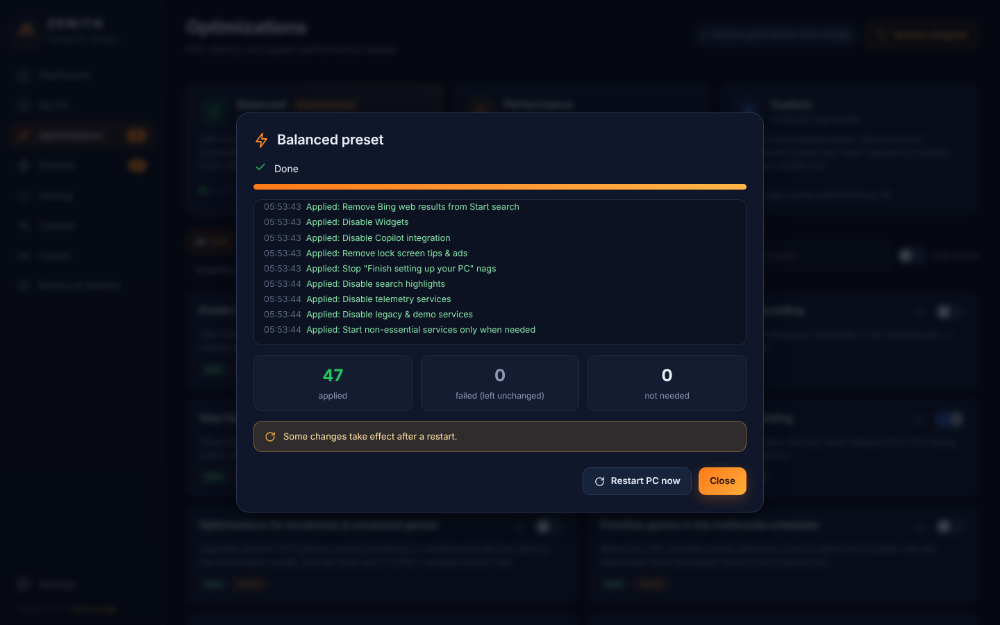
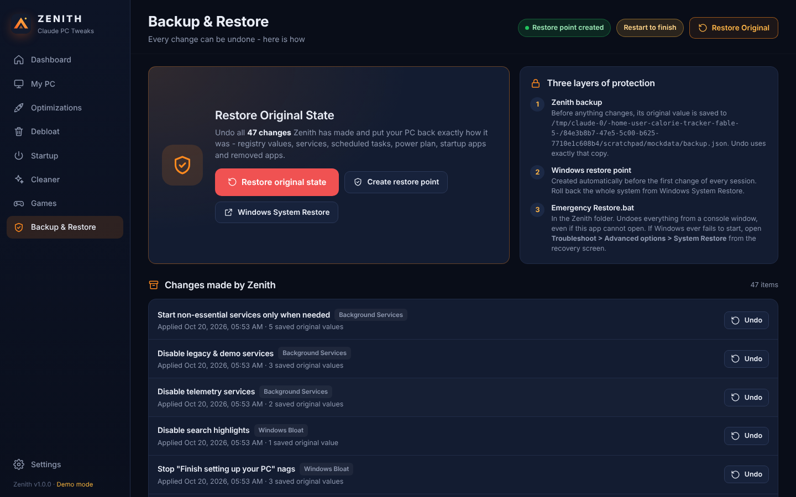

# Zenith — PC optimizer (Claude PC Tweaks)

**Peak performance for your rig.** Zenith is a Hone-style FPS and latency optimizer built for this gaming PC:

| | |
|---|---|
| CPU | AMD Ryzen 7 5800X (8 cores / 16 threads) |
| GPU | NVIDIA GeForce RTX 3070 8 GB |
| RAM | 64 GB DDR4 @ 2400 MT/s |
| Storage | 2.29 TB (1.59 TB used) |
| System | ASUS ROG STRIX G15DK · Windows 11 Home 25H2 |

It scans your PC, shows a health check with recommendations, and gives you **73 reversible tweaks** for FPS,
input latency, background processes and Windows debloat. It also includes a startup-apps manager, bloatware
remover, disk cleaner, games library with one-click Game Boost, and a system-file repair tool.

**Every change can be undone with one button**, and Zenith creates a Windows restore point before it changes anything.



> Screenshots were taken in Zenith's demo mode, so values like the monitor, process count and driver date are sample data.
> On your PC, Zenith shows what it actually finds.

<table>
<tr><td><br><sub><b>My PC</b>: hardware scan and health check</sub></td>
<td><br><sub><b>Optimizations</b>: presets and 47 performance tweaks</sub></td></tr>
<tr><td><br><sub><b>Debloat</b>: privacy tweaks and bloatware removal</sub></td>
<td><br><sub><b>Games</b>: Game Boost, RTX 3070 tips, library</sub></td></tr>
<tr><td><br><sub>Every change is logged as it is applied</sub></td>
<td><br><sub><b>Backup & Restore</b>: one-click Restore Original</sub></td></tr>
</table>

---

## Download and start

1. Download this folder:
   - **Easiest:** download [`Zenith-v1.0.zip`](Zenith-v1.0.zip) from this folder (open it on GitHub, then click the download button), **or**
   - on the repository page click **Code → Download ZIP** and use the `Zenith (Claude PC Tweaks)` folder inside.
2. Right-click the zip → **Extract All…** (for example to your Desktop or `C:\Zenith`).
3. Open the extracted folder and double-click **`Launch Zenith.bat`**.
4. Windows asks *"Do you want to allow this app to make changes?"* → **Yes**. Zenith needs administrator rights to change system settings.
5. The Zenith window opens. Optional: **Settings → Desktop shortcut** adds a Zenith icon to your desktop.

If Windows SmartScreen shows *"Windows protected your PC"*, click **More info → Run anyway**. That warning
appears for any downloaded script that is not signed. Zenith has no installer and no .exe: it is plain
PowerShell and HTML that you can open in Notepad and read.

**Requirements:** Windows 10 or 11 (64-bit). Uses the built-in Windows PowerShell 5.1 and opens in a Microsoft Edge
app window (Chrome or your default browser if Edge is missing). Nothing is installed and nothing runs at startup.

---

## Recommended first run

1. **My PC**: read the health check. It finds problems that tweaks can't fix, which are often the biggest wins.
2. **Optimizations → Balanced → Apply**. These are safe tweaks with no trade-offs. A restore point is created first.
3. **Restart** the PC (the *Restart to finish* button appears when a tweak needs it).
4. Optional: **Performance** preset (adds tweaks with small trade-offs; read each description).
5. **Debloat**: apply the safe debloat tweaks, then remove the bloatware apps you don't use.
6. **Startup**: turn off apps you don't need at startup. This is the biggest reduction of your ~300 processes,
   together with *Group service processes* (Memory) and the ASUS Armoury Crate services tweak.
7. **Games → Game Boost** right before you play.

### Biggest gains for your specific PC (BIOS settings)

Zenith's scanner checks these, but they are **BIOS settings that no Windows tweak can change**:

- **RAM runs at 2400 MT/s.** A Ryzen 5000 CPU performs best with 3200–3600 MT/s, and on Ryzen the memory
  speed also sets the Infinity Fabric clock. If your sticks are rated higher, enable **D.O.C.P.** in the BIOS
  (Delete at boot → *Ai Tweaker* → *Ai Overclock Tuner* → *D.O.C.P.* → F10). This is typically worth
  **5–15% more FPS in CPU-bound games**, more than any Windows tweak. With four 16 GB sticks, 3200 MT/s is the
  reliable target. If your sticks really are 2400 MT/s modules, a DDR4-3200 CL16 kit is the best-value upgrade.
- **Resizable BAR**: BIOS → *Advanced → PCI Subsystem Settings* → *Above 4G Decoding: Enabled*, *Re-Size BAR: Auto*
  (CSM disabled). Worth 0–10% depending on the game.
- **Monitor refresh rate**: make sure Windows runs your monitor at its maximum Hz (Zenith flags this if it's set lower).

Zenith shows step-by-step guides for D.O.C.P. and Resizable BAR in the app.

### What to expect

Windows tweaks mostly give **smoother frame times, lower input latency, faster responsiveness and fewer
background interruptions**. Average-FPS gains are usually a few percent, more on a PC with a lot of
background software. Any tool promising "+100 FPS" from registry tweaks alone is overselling. Zenith is honest
about what each tweak does and shows the exact setting it changes.

---

## Safety: how undo works

Zenith has three layers of protection:

1. **Zenith backup.** Before *any* setting changes, its original value is saved to
   `C:\ProgramData\Zenith\backup.json` (registry values and types, keys that didn't exist, service start types,
   scheduled-task states, your power plan, startup-app flags, removed apps). The **Restore Original** button
   (top right of every page, and on *Backup & Restore*) replays that backup and puts everything back exactly
   as it was, removing keys Zenith created and deleting the Zenith power plan. Each tweak can also be undone on its own with its toggle.
2. **Windows restore point.** Created automatically before the first change of every session (Zenith
   temporarily lifts Windows' one-per-24-hours limit and turns on System Protection for C: if it's off).
3. **`Emergency Restore.bat`.** In this folder. It undoes everything from a console window, even if the Zenith
   window won't open.

If Windows ever fails to start (no tweak in Zenith should cause that): on the blue recovery screen choose
**Troubleshoot → Advanced options → System Restore** and pick *"Zenith - before optimizations"*.

Other safety rules built into Zenith:

- A tweak is applied as a unit. If any step fails, the steps already done for that tweak are rolled back.
- Presets only contain **Safe** tweaks (Balanced) or Safe + **Moderate** tweaks (Performance). **Advanced** and
  **Experimental** tweaks are manual-only and show a warning first.
- The engine only listens on `127.0.0.1` and needs a random per-session key, so websites can't control it.
  It has no "run any command" function, only the tweaks in its catalog.

**Zenith never:** disables Windows Defender, Windows Update, the firewall or UAC · removes the Microsoft Store,
Edge, Xbox sign-in or system components · edits boot settings (BCD; these can trigger BitLocker recovery) ·
disables the page file or CPU power states · runs a "registry cleaner" · deletes drivers, shader caches or your files.

---

## What's inside

| Page | What it does |
|---|---|
| **Dashboard** | Optimization score, live CPU/GPU/RAM usage (GPU temperature via the NVIDIA driver), recommendations with *Apply all*, PC health highlights |
| **My PC** | Full scan: CPU, every RAM stick (speed, rated speed from the part number), GPU (real VRAM, driver age, Resizable BAR), displays (current vs. max refresh rate), drives, network, Windows build and uptime, and a health check with fixes |
| **Optimizations** | Balanced / Performance presets and 47 performance tweaks in 9 categories, with search and filters. ⓘ on any tweak shows exactly which settings it changes |
| **Debloat** | 26 privacy, telemetry, bloat and background-service tweaks, plus removal of 33 known bloatware apps (allow-list only) |
| **Startup** | Turn startup apps on/off (same switch Task Manager uses; nothing is deleted) |
| **Cleaner** | Shows sizes first, then cleans temp files, update caches, crash dumps, thumbnails, old logs, Recycle Bin, DISM component cleanup |
| **Games** | Detects Steam, Epic Games and Riot games, launches them, **Game Boost** (closes selected background apps, frees standby RAM, flushes DNS) and RTX 3070 settings tips |
| **Backup & Restore** | Restore Original, every recorded change with its own Undo, Windows restore points, activity log |
| **Settings** | Automatic restore points, show/hide advanced tweaks, desktop shortcut, repair Windows files (DISM + SFC), restart Explorer / PC |

### Files

```
Zenith (Claude PC Tweaks)/
  Launch Zenith.bat        start Zenith
  Emergency Restore.bat    undo everything without opening the app
  Zenith-v1.0.zip          this folder as a single download
  app/Zenith.ps1           launcher + engine entry point
  app/core/                Platform (Windows APIs), Engine (backup/undo), Tweaks (catalog),
                           Scanner, Tools, Server (local UI server)
  app/ui/                  the interface (HTML/CSS/JS, works offline)
  app/tests/               automated tests (run in demo mode, change nothing)
```

Zenith stores its data in `C:\ProgramData\Zenith` (backup, settings, logs) and the app window's browser
profile in `%LOCALAPPDATA%\Zenith`. **To uninstall:** click *Restore Original*, then delete this folder and
those two folders.

### For developers

- Demo mode (simulated PC, no system changes, works on any OS with PowerShell 7):
  `pwsh app/Zenith.ps1 -Serve -Mock -NoBrowser -Port 8765 -Token dev`, then open `http://127.0.0.1:8765/?t=dev`.
- Tests: `powershell -NoProfile -ExecutionPolicy Bypass -File app\tests\Engine.Tests.ps1` applies every tweak to the
  simulated PC, checks each one, restores everything and verifies the simulated PC is **identical** to how it started.

---

## Full tweak list (73)

*Balanced* = in both presets · *Performance* = Performance preset only · *manual* = only when you switch it on.
Tweaks marked *(restart)* take effect after a restart.

#### Gaming & FPS <sub>(Optimizations page)</sub>

| Tweak | Risk | Preset | What it changes |
|---|---|---|---|
| **Enable Windows Game Mode**<br>Tells Windows to prioritise the game you are playing and hold back Windows Update installs and restarts while you play. | Safe | Balanced | `Registry: HKCU\Software\Microsoft\GameBar \ AutoGameModeEnabled = 1`<br>`Registry: HKCU\Software\Microsoft\GameBar \ AllowAutoGameMode = 1` |
| **Disable Game DVR background recording**<br>Stops Xbox Game Bar from silently recording your gameplay in the background - a common cause of FPS drops and stutter. | Safe | Balanced | `Registry: HKCU\System\GameConfigStore \ GameDVR_Enabled = 0`<br>`Registry: HKCU\Software\Microsoft\Windows\CurrentVersion\GameDVR \ AppCaptureEnabled = 0`<br>`Registry: HKCU\Software\Microsoft\Windows\CurrentVersion\GameDVR \ HistoricalCaptureEnabled = 0`<br>`Registry: HKLM\SOFTWARE\Policies\Microsoft\Windows\GameDVR \ AllowGameDVR = 0` |
| **Stop Game Bar popping up on controller press**<br>Stops the Xbox button on your controller from opening Game Bar in the middle of a match, and hides the Game Bar startup tips. | Safe | Balanced | `Registry: HKCU\Software\Microsoft\GameBar \ UseNexusForGameBarEnabled = 0`<br>`Registry: HKCU\Software\Microsoft\GameBar \ ShowStartupPanel = 0`<br>`Registry: HKCU\Software\Microsoft\GameBar \ GamePanelStartupTipIndex = 3` |
| **Hardware-accelerated GPU scheduling *(restart)***<br>Lets your RTX 3070 schedule its own video memory work instead of the CPU doing it, lowering CPU overhead and input latency. | Safe | Balanced | `Registry: HKLM\SYSTEM\CurrentControlSet\Control\GraphicsDrivers \ HwSchMode = 2` |
| **Optimizations for borderless & windowed games**<br>Upgrades DirectX 10/11 games running borderless or windowed to the low-latency flip presentation model, and lets them use G-SYNC / variable refresh rate. | Safe | Balanced | `Registry: HKCU\Software\Microsoft\DirectX\UserGpuPreferences \ DirectXUserGlobalSettings gets VRROptimizeEnable=1; SwapEffectUpgradeEnable=1` |
| **Prioritise games in the multimedia scheduler**<br>Raises the CPU and disk priority Windows gives to games that register with the Multimedia Class Scheduler (most DirectX games do). | Safe | Balanced | `Registry: HKLM\SOFTWARE\Microsoft\Windows NT\CurrentVersion\Multimedia\SystemProfile\Tasks\Games \ GPU Priority = 8`<br>`Registry: HKLM\SOFTWARE\Microsoft\Windows NT\CurrentVersion\Multimedia\SystemProfile\Tasks\Games \ Priority = 6`<br>`Registry: HKLM\SOFTWARE\Microsoft\Windows NT\CurrentVersion\Multimedia\SystemProfile\Tasks\Games \ Scheduling Category = "High"`<br>`Registry: HKLM\SOFTWARE\Microsoft\Windows NT\CurrentVersion\Multimedia\SystemProfile\Tasks\Games \ SFIO Priority = "High"` |
| **Reserve less CPU for background media**<br>Lowers the share of CPU time Windows reserves for background multimedia tasks from 20% to 10%, leaving more for your game. | Safe | Balanced | `Registry: HKLM\SOFTWARE\Microsoft\Windows NT\CurrentVersion\Multimedia\SystemProfile \ SystemResponsiveness = 10` |
| **Boost the foreground app**<br>Gives the window you are using - your game - longer, boosted CPU time slices compared with programs running in the background. | Safe | Balanced | `Registry: HKLM\SYSTEM\CurrentControlSet\Control\PriorityControl \ Win32PrioritySeparation = 38` |
| **Disable mouse acceleration**<br>Turns off "Enhance pointer precision" so your crosshair moves exactly as far as your hand does - essential for consistent aim. | Safe | Balanced | `Registry: HKCU\Control Panel\Mouse \ MouseSpeed = "0"`<br>`Registry: HKCU\Control Panel\Mouse \ MouseThreshold1 = "0"`<br>`Registry: HKCU\Control Panel\Mouse \ MouseThreshold2 = "0"` |
| **Disable Sticky Keys pop-ups**<br>Stops the Sticky Keys / Filter Keys prompt from appearing - and minimising your game - when you tap or hold Shift. | Safe | Balanced | `Registry: HKCU\Control Panel\Accessibility\StickyKeys \ Flags = "506"`<br>`Registry: HKCU\Control Panel\Accessibility\Keyboard Response \ Flags = "122"`<br>`Registry: HKCU\Control Panel\Accessibility\ToggleKeys \ Flags = "58"` |
| **Disable fullscreen optimizations (global)**<br>Forces classic exclusive fullscreen in older games that support it. Can lower latency in some DX9/DX11 titles, but breaks Auto HDR and quick Alt+Tab. | Moderate | manual | `Registry: HKCU\System\GameConfigStore \ GameDVR_FSEBehaviorMode = 2`<br>`Registry: HKCU\System\GameConfigStore \ GameDVR_HonorUserFSEBehaviorMode = 1`<br>`Registry: HKCU\System\GameConfigStore \ GameDVR_FSEBehavior = 2`<br>... and 2 more |
| **Disable Multi-Plane Overlay (flicker fix) *(restart)***<br>Fixes flickering, black flashes and stutter that some NVIDIA users see in games and browsers, mostly on multi-monitor setups. | Moderate | manual | `Registry: HKLM\SOFTWARE\Microsoft\Windows\Dwm \ OverlayTestMode = 5` |

#### Input & Latency <sub>(Optimizations page)</sub>

| Tweak | Risk | Preset | What it changes |
|---|---|---|---|
| **Disable USB selective suspend**<br>Stops Windows putting USB ports to sleep, which prevents mouse, keyboard and headset drop-outs or wake-up lag. | Safe | Balanced | `Power plan: USB selective suspend -> 0` |
| **Disable PCIe link power saving**<br>Keeps the PCI Express links to your graphics card and NVMe drive at full power, so they never have to wake up mid-game. | Safe | Performance | `Power plan: PCI Express link state power management -> 0` |
| **Global timer resolution *(restart)***<br>Restores the classic behaviour where a game that asks for a high-precision timer (0.5 ms) gets it system-wide. Can smooth frame pacing in some titles. | Moderate | manual | `Registry: HKLM\SYSTEM\CurrentControlSet\Control\Session Manager\kernel \ GlobalTimerResolutionRequests = 1` |

#### CPU & Power <sub>(Optimizations page)</sub>

| Tweak | Risk | Preset | What it changes |
|---|---|---|---|
| **Zenith Ultimate Performance power plan**<br>Creates and activates a maximum-performance power plan so your Ryzen 7 5800X ramps to full boost instantly instead of waiting to clock up. | Safe | Balanced | `Power plan: create and activate 'Zenith Ultimate Performance' (your sleep and screen timeouts are kept)` |
| **Disable CPU core parking**<br>Keeps all 8 cores / 16 threads awake so game threads never land on a parked core that has to wake up first. | Safe | Balanced | `Power plan: Core parking minimum cores (%) -> 100` |
| **Aggressive processor boost**<br>Asks AMD Precision Boost for the highest clocks as early as possible when load appears. | Safe | Performance | `Power plan: Processor performance boost mode (2 = Aggressive) -> 2` |
| **Disable power throttling**<br>Stops Windows slowing down apps it thinks are in the background (launchers, voice chat, overlays). It is a laptop battery feature you do not need on a desktop. | Safe | Balanced | `Registry: HKLM\SYSTEM\CurrentControlSet\Control\Power\PowerThrottling \ PowerThrottlingOff = 1` |
| **Disable hibernation (frees ~25 GB)**<br>Deletes hiberfil.sys, which on a 64 GB RAM PC takes up roughly 25 GB of your system drive. Normal sleep keeps working. | Safe | Balanced | `powercfg /hibernate off (deletes hiberfil.sys)` |
| **Turn off Memory Integrity (HVCI) *(restart)***<br>Removes the virtualization-based security overhead that Microsoft itself says can reduce gaming performance. Typically a few percent more FPS in CPU-heavy games. | Advanced | manual | `Registry: HKLM\SYSTEM\CurrentControlSet\Control\DeviceGuard\Scenarios\HypervisorEnforcedCodeIntegrity \ Enabled = 0` |

#### Memory <sub>(Optimizations page)</sub>

| Tweak | Risk | Preset | What it changes |
|---|---|---|---|
| **Group service processes (far fewer processes) *(restart)***<br>With more than 3.5 GB of RAM Windows gives every service its own svchost.exe. On your 64 GB PC that means dozens of extra processes - this groups them again. | Moderate | Performance | `(detected for your hardware at apply time)` |
| **Keep the Windows kernel in RAM *(restart)***<br>With 64 GB of RAM there is no reason to page kernel-mode drivers and system code out to disk. Keeps them in memory for quicker responses. | Safe | Balanced | `Registry: HKLM\SYSTEM\CurrentControlSet\Control\Session Manager\Memory Management \ DisablePagingExecutive = 1` |
| **Disable SysMain (Superfetch)**<br>Stops Windows pre-loading apps into RAM in the background. With 64 GB and SSD storage the benefit is small and it can cause disk spikes while gaming. | Moderate | Performance | `Service: SysMain -> Disabled (and stopped now)` |

#### Graphics <sub>(Optimizations page)</sub>

| Tweak | Risk | Preset | What it changes |
|---|---|---|---|
| **Increase GPU timeout tolerance *(restart)***<br>Gives the graphics driver 10 seconds instead of 2 before Windows resets it, preventing "display driver stopped responding" crashes during heavy shader compilation. | Safe | Performance | `Registry: HKLM\SYSTEM\CurrentControlSet\Control\GraphicsDrivers \ TdrDelay = 10` |
| **Disable NVIDIA telemetry tasks**<br>Turns off the NVIDIA crash and usage reporting tasks that run in the background. The driver, control panel and NVIDIA App keep working. | Safe | Balanced | `(detected for your hardware at apply time)` |
| **Enable MSI interrupt mode for your GPU *(restart)***<br>Switches your graphics card to Message Signaled Interrupts, which can lower interrupt latency. Most RTX cards already use it - Zenith shows "Already optimal" if so. | Advanced | manual | `(detected for your hardware at apply time)` |
| **Stop Windows Update replacing your GPU driver**<br>Prevents Windows Update from silently installing older or generic drivers over the NVIDIA driver you installed - a classic cause of sudden stutter and crashes. | Moderate | manual | `Registry: HKLM\SOFTWARE\Microsoft\Windows\CurrentVersion\DriverSearching \ SearchOrderConfig = 0`<br>`Registry: HKLM\SOFTWARE\Policies\Microsoft\Windows\WindowsUpdate \ ExcludeWUDriversInQualityUpdate = 1` |

#### Network <sub>(Optimizations page)</sub>

| Tweak | Risk | Preset | What it changes |
|---|---|---|---|
| **Disable network throttling**<br>Removes the Windows cap on network packet processing that kicks in while audio or video plays, which can add latency to online games. | Safe | Balanced | `Registry: HKLM\SOFTWARE\Microsoft\Windows NT\CurrentVersion\Multimedia\SystemProfile \ NetworkThrottlingIndex = 4294967295` |
| **Disable Nagle's algorithm**<br>Sends small TCP packets immediately instead of bundling them, reducing latency in games that use TCP (MMOs, some MOBAs and launchers). | Safe | Performance | `(detected for your hardware at apply time)` |
| **Disable Energy-Efficient Ethernet**<br>Stops your wired network adapter dropping into power-saving states between packets, which can cause small ping spikes. | Moderate | Performance | `(detected for your hardware at apply time)` |
| **Stop Windows switching off network adapters *(restart)***<br>Unticks "Allow the computer to turn off this device to save power" for your network adapters, preventing disconnects and wake-up lag. | Safe | Performance | `(detected for your hardware at apply time)` |
| **Disable peer-to-peer update sharing**<br>Stops Windows uploading updates to other PCs over the internet (Delivery Optimization), which can eat your upload bandwidth and raise ping. | Safe | Balanced | `Registry: HKLM\SOFTWARE\Policies\Microsoft\Windows\DeliveryOptimization \ DODownloadMode = 0` |

#### Storage <sub>(Optimizations page)</sub>

| Tweak | Risk | Preset | What it changes |
|---|---|---|---|
| **Make sure SSD TRIM is on**<br>Checks that Windows tells your SSDs which blocks are free (TRIM), which keeps write speeds high and wear low over time. | Safe | Balanced | `fsutil behavior set DisableDeleteNotify 0` |
| **Disable last-access timestamps**<br>Stops NTFS writing a "last opened" time to disk every time any file is read, cutting small background writes. | Safe | Balanced | `fsutil behavior set disablelastaccess 1` |
| **Turn on Storage Sense**<br>Lets Windows automatically clear temporary files when your drive starts running low on space. | Safe | Balanced | `Registry: HKCU\Software\Microsoft\Windows\CurrentVersion\StorageSense\Parameters\StoragePolicy \ 01 = 1`<br>`Registry: HKCU\Software\Microsoft\Windows\CurrentVersion\StorageSense\Parameters\StoragePolicy \ 04 = 1` |
| **Disable Windows Search indexing**<br>Stops the search indexer crawling your drives in the background. Finding apps in Start still works; searching inside documents gets slower. | Moderate | manual | `Service: WSearch -> Disabled (and stopped now)` |

#### Stability <sub>(Optimizations page)</sub>

| Tweak | Risk | Preset | What it changes |
|---|---|---|---|
| **Disable Fast Startup**<br>Makes "Shut down" a real shutdown. Fast Startup keeps the kernel hibernated between boots - a common cause of driver glitches and bugs that only a restart fixes. | Safe | Balanced | `Registry: HKLM\SYSTEM\CurrentControlSet\Control\Session Manager\Power \ HiberbootEnabled = 0` |
| **No surprise update restarts**<br>Stops Windows Update restarting your PC on its own while you are signed in - for example in the middle of a match. You restart when it suits you. | Safe | Balanced | `Registry: HKLM\SOFTWARE\Policies\Microsoft\Windows\WindowsUpdate\AU \ NoAutoRebootWithLoggedOnUsers = 1` |

#### Interface <sub>(Optimizations page)</sub>

| Tweak | Risk | Preset | What it changes |
|---|---|---|---|
| **Remove the startup app delay**<br>Windows waits about 10 seconds after sign-in before starting your startup apps. This removes the artificial wait. | Safe | Balanced | `Registry: HKCU\Software\Microsoft\Windows\CurrentVersion\Explorer\Serialize \ StartupDelayInMSec = 0` |
| **Faster menus**<br>Cuts the delay before sub-menus open from 400 ms to 100 ms, so Windows feels snappier. | Safe | Balanced | `Registry: HKCU\Control Panel\Desktop \ MenuShowDelay = "100"` |
| **Reduce window animations**<br>Turns off the minimise/maximise and taskbar animations so windows appear instantly. | Safe | Performance | `Registry: HKCU\Control Panel\Desktop\WindowMetrics \ MinAnimate = "0"`<br>`Registry: HKCU\Software\Microsoft\Windows\CurrentVersion\Explorer\Advanced \ TaskbarAnimations = 0` |
| **Disable transparency effects**<br>Turns off the see-through blur behind the taskbar and Start menu, saving a little GPU work on the desktop. | Safe | Performance | `Registry: HKCU\Software\Microsoft\Windows\CurrentVersion\Themes\Personalize \ EnableTransparency = 0` |
| **Classic right-click menu**<br>Brings back the full Windows 10 style right-click menu, so you never have to click "Show more options". | Safe | manual | `Registry: HKCU\Software\Classes\CLSID\{86ca1aa0-34aa-4e8b-a509-50c905bae2a2}\InprocServer32 \ (Default) = ""` |
| **Show file extensions**<br>Shows ".exe", ".zip" and friends in File Explorer - a simple way to spot fake files such as "setup.pdf.exe". | Safe | Balanced | `Registry: HKCU\Software\Microsoft\Windows\CurrentVersion\Explorer\Advanced \ HideFileExt = 0` |
| **Add "End task" to the taskbar**<br>Adds an "End task" option when you right-click a taskbar app, so you can kill a frozen game without opening Task Manager. | Safe | Balanced | `Registry: HKCU\Software\Microsoft\Windows\CurrentVersion\Explorer\Advanced\TaskbarDeveloperSettings \ TaskbarEndTask = 1` |
| **Fastest keyboard repeat**<br>Sets the shortest delay and fastest rate for repeating keys when you hold them down. | Safe | manual | `Registry: HKCU\Control Panel\Keyboard \ KeyboardDelay = "0"`<br>`Registry: HKCU\Control Panel\Keyboard \ KeyboardSpeed = "31"` |

#### Privacy & Telemetry <sub>(Debloat page)</sub>

| Tweak | Risk | Preset | What it changes |
|---|---|---|---|
| **Set diagnostic data to minimum**<br>Limits the diagnostic data Windows sends to Microsoft to the lowest level your edition allows (on Windows 11 Home that is "Required"). | Safe | Balanced | `Registry: HKLM\SOFTWARE\Policies\Microsoft\Windows\DataCollection \ AllowTelemetry = 0` |
| **Disable telemetry scheduled tasks**<br>Turns off the compatibility appraiser, CEIP and feedback tasks that wake up in the background and cause CPU and disk spikes. | Safe | Balanced | `Scheduled task: \Microsoft\Windows\Application Experience\Microsoft Compatibility Appraiser -> disabled`<br>`Scheduled task: \Microsoft\Windows\Application Experience\ProgramDataUpdater -> disabled`<br>`Scheduled task: \Microsoft\Windows\Application Experience\MareBackup -> disabled`<br>... and 7 more |
| **Disable advertising ID**<br>Stops apps using your advertising ID to show you personalised ads. | Safe | Balanced | `Registry: HKCU\Software\Microsoft\Windows\CurrentVersion\AdvertisingInfo \ Enabled = 0`<br>`Registry: HKLM\SOFTWARE\Policies\Microsoft\Windows\AdvertisingInfo \ DisabledByGroupPolicy = 1` |
| **Disable tailored experiences**<br>Stops Microsoft using your diagnostic data to show personalised tips, ads and recommendations. | Safe | Balanced | `Registry: HKCU\Software\Microsoft\Windows\CurrentVersion\Privacy \ TailoredExperiencesWithDiagnosticDataEnabled = 0` |
| **Disable activity history**<br>Stops Windows recording which apps and files you use and uploading that timeline. | Safe | Balanced | `Registry: HKLM\SOFTWARE\Policies\Microsoft\Windows\System \ EnableActivityFeed = 0`<br>`Registry: HKLM\SOFTWARE\Policies\Microsoft\Windows\System \ PublishUserActivities = 0`<br>`Registry: HKLM\SOFTWARE\Policies\Microsoft\Windows\System \ UploadUserActivities = 0` |
| **Stop feedback requests**<br>No more "How likely are you to recommend Windows?" pop-ups. | Safe | Balanced | `Registry: HKCU\Software\Microsoft\Siuf\Rules \ NumberOfSIUFInPeriod = 0`<br>`Registry: HKLM\SOFTWARE\Policies\Microsoft\Windows\DataCollection \ DoNotShowFeedbackNotifications = 1` |
| **Disable typing & inking data collection**<br>Stops Windows collecting what you type and write to "improve" its dictionary. | Safe | Balanced | `Registry: HKCU\Software\Microsoft\InputPersonalization \ RestrictImplicitInkCollection = 1`<br>`Registry: HKCU\Software\Microsoft\InputPersonalization \ RestrictImplicitTextCollection = 1`<br>`Registry: HKCU\Software\Microsoft\InputPersonalization\TrainedDataStore \ HarvestContacts = 0`<br>`Registry: HKCU\Software\Microsoft\Personalization\Settings \ AcceptedPrivacyPolicy = 0` |
| **Leave the Customer Experience Program**<br>Opts out of the Windows Customer Experience Improvement Program. | Safe | Balanced | `Registry: HKLM\SOFTWARE\Policies\Microsoft\SQMClient\Windows \ CEIPEnable = 0` |
| **Disable Windows Error Reporting uploads**<br>Stops Windows collecting and uploading crash reports in the background after an app crashes. | Safe | Balanced | `Registry: HKLM\SOFTWARE\Microsoft\Windows\Windows Error Reporting \ Disabled = 1` |
| **Disable online speech recognition**<br>Stops voice input being sent to Microsoft cloud speech services. | Safe | Balanced | `Registry: HKCU\Software\Microsoft\Speech_OneCore\Settings\OnlineSpeechPrivacy \ HasAccepted = 0` |

#### Windows Bloat <sub>(Debloat page)</sub>

| Tweak | Risk | Preset | What it changes |
|---|---|---|---|
| **Remove ads & suggestions in Start and Settings**<br>Hides "suggested" apps, tips and promotions in the Start menu and the Settings app. | Safe | Balanced | `Registry: HKCU\Software\Microsoft\Windows\CurrentVersion\ContentDeliveryManager \ SubscribedContent-338388Enabled = 0`<br>`Registry: HKCU\Software\Microsoft\Windows\CurrentVersion\ContentDeliveryManager \ SubscribedContent-338389Enabled = 0`<br>`Registry: HKCU\Software\Microsoft\Windows\CurrentVersion\ContentDeliveryManager \ SubscribedContent-338393Enabled = 0`<br>... and 4 more |
| **Stop sponsored apps installing themselves**<br>Stops Windows quietly downloading games like Candy Crush and other promoted apps onto your PC. | Safe | Balanced | `Registry: HKCU\Software\Microsoft\Windows\CurrentVersion\ContentDeliveryManager \ SilentInstalledAppsEnabled = 0`<br>`Registry: HKCU\Software\Microsoft\Windows\CurrentVersion\ContentDeliveryManager \ OemPreInstalledAppsEnabled = 0`<br>`Registry: HKCU\Software\Microsoft\Windows\CurrentVersion\ContentDeliveryManager \ PreInstalledAppsEnabled = 0`<br>`Registry: HKCU\Software\Microsoft\Windows\CurrentVersion\ContentDeliveryManager \ PreInstalledAppsEverEnabled = 0` |
| **Remove Bing web results from Start search**<br>Start menu search only looks at your PC, so it is faster and does not send what you type to Bing. | Safe | Balanced | `Registry: HKCU\Software\Policies\Microsoft\Windows\Explorer \ DisableSearchBoxSuggestions = 1`<br>`Registry: HKCU\Software\Microsoft\Windows\CurrentVersion\Search \ BingSearchEnabled = 0` |
| **Disable Widgets**<br>Turns off the Widgets board and its news feed, which keeps several web processes running in the background. | Safe | Balanced | `Registry: HKLM\SOFTWARE\Policies\Microsoft\Dsh \ AllowNewsAndInterests = 0` |
| **Disable Copilot integration**<br>Turns off the built-in Copilot integration and hides its taskbar button. (The Copilot app itself can be removed under Bloatware apps.) | Safe | Balanced | `Registry: HKCU\Software\Policies\Microsoft\Windows\WindowsCopilot \ TurnOffWindowsCopilot = 1`<br>`Registry: HKLM\SOFTWARE\Policies\Microsoft\Windows\WindowsCopilot \ TurnOffWindowsCopilot = 1`<br>`Registry: HKCU\Software\Microsoft\Windows\CurrentVersion\Explorer\Advanced \ ShowCopilotButton = 0` |
| **Remove lock screen tips & ads**<br>Removes the "fun facts", tips and promotions shown on the lock screen. | Safe | Balanced | `Registry: HKCU\Software\Microsoft\Windows\CurrentVersion\ContentDeliveryManager \ RotatingLockScreenOverlayEnabled = 0`<br>`Registry: HKCU\Software\Microsoft\Windows\CurrentVersion\ContentDeliveryManager \ SubscribedContent-338387Enabled = 0` |
| **Stop "Finish setting up your PC" nags**<br>Stops the full-screen "Let us finish setting up your device" prompts and account nags after updates. | Safe | Balanced | `Registry: HKCU\Software\Microsoft\Windows\CurrentVersion\UserProfileEngagement \ ScoobeSystemSettingEnabled = 0`<br>`Registry: HKCU\Software\Microsoft\Windows\CurrentVersion\ContentDeliveryManager \ SubscribedContent-310093Enabled = 0`<br>`Registry: HKCU\Software\Microsoft\Windows\CurrentVersion\Explorer\Advanced \ Start_AccountNotifications = 0` |
| **Disable search highlights**<br>Removes the daily doodles and trending content from the search box and search panel. | Safe | Balanced | `Registry: HKCU\Software\Microsoft\Windows\CurrentVersion\SearchSettings \ IsDynamicSearchBoxEnabled = 0` |

#### Background Services <sub>(Debloat page)</sub>

| Tweak | Risk | Preset | What it changes |
|---|---|---|---|
| **Disable telemetry services**<br>Stops "Connected User Experiences and Telemetry" and the WAP push service that feeds it - both run all the time and use CPU and disk. | Safe | Balanced | `Service: DiagTrack -> Disabled (and stopped now)`<br>`Service: dmwappushservice -> Disabled (and stopped now)` |
| **Disable legacy & demo services**<br>Disables Fax, the in-store Retail Demo, Remote Registry and Windows Media Player network sharing - none are used on a gaming PC. | Safe | Balanced | `Service: Fax -> Disabled (and stopped now)`<br>`Service: RetailDemo -> Disabled (and stopped now)`<br>`Service: RemoteRegistry -> Disabled (and stopped now)`<br>`Service: WMPNetworkSvc -> Disabled (and stopped now)` |
| **Start non-essential services only when needed**<br>Switches Maps Manager, Link Tracking, Program Compatibility Assistant and the Edge updater from "always start" to "start on demand". Nothing breaks - they still run when something needs them. | Safe | Balanced | `Service: MapsBroker -> Manual (and stopped now)`<br>`Service: TrkWks -> Manual (and stopped now)`<br>`Service: PcaSvc -> Manual (and stopped now)`<br>... and 2 more |
| **Disable Print Spooler**<br>Only if you never print: stops the printing service that runs all the time. | Moderate | manual | `Service: Spooler -> Disabled (and stopped now)` |
| **ASUS Armoury Crate services on demand**<br>Your ROG STRIX G15DK ships with a stack of ASUS services that run 24/7. Setting them to start on demand removes 6-10 background processes. | Moderate | manual | `Service: ArmouryCrateService -> Manual (and stopped now)`<br>`Service: AsusAppService -> Manual (and stopped now)`<br>`Service: ASUSOptimization -> Manual (and stopped now)`<br>... and 10 more |

#### Background Apps <sub>(Debloat page)</sub>

| Tweak | Risk | Preset | What it changes |
|---|---|---|---|
| **Stop Store apps running in the background**<br>Prevents Microsoft Store apps (Mail, Weather, Phone Link...) from running and syncing in the background. | Moderate | Performance | `Registry: HKCU\Software\Microsoft\Windows\CurrentVersion\BackgroundAccessApplications \ GlobalUserDisabled = 1`<br>`Registry: HKCU\Software\Microsoft\Windows\CurrentVersion\Search \ BackgroundAppGlobalToggle = 0` |
| **Stop Edge running in the background**<br>Stops Microsoft Edge pre-loading at sign-in (Startup Boost) and staying alive after you close it - often a dozen hidden msedge.exe processes. | Safe | Performance | `Registry: HKLM\SOFTWARE\Policies\Microsoft\Edge \ StartupBoostEnabled = 0`<br>`Registry: HKLM\SOFTWARE\Policies\Microsoft\Edge \ BackgroundModeEnabled = 0` |
| **Stop Chrome running in the background**<br>Stops Google Chrome keeping processes alive after you close its last window. | Safe | Performance | `(detected for your hardware at apply time)` |

